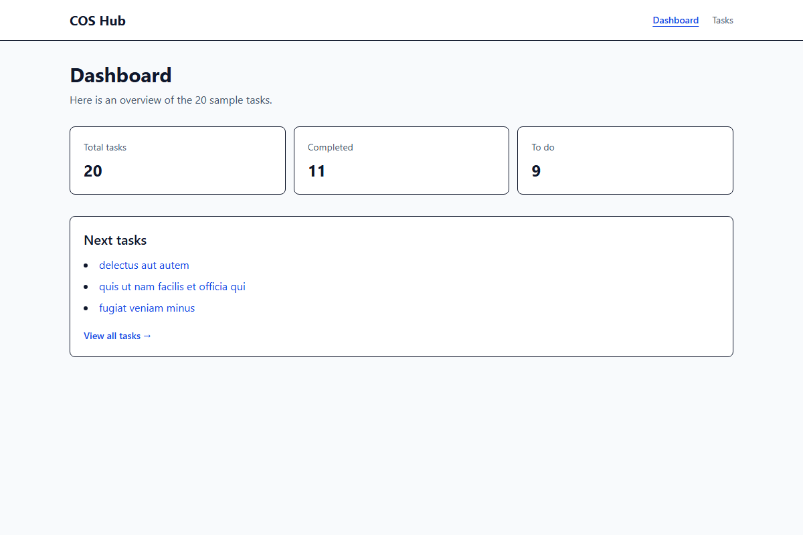
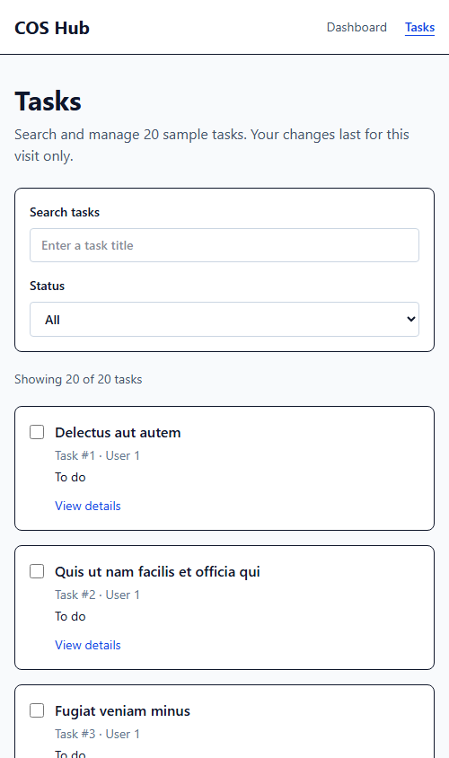
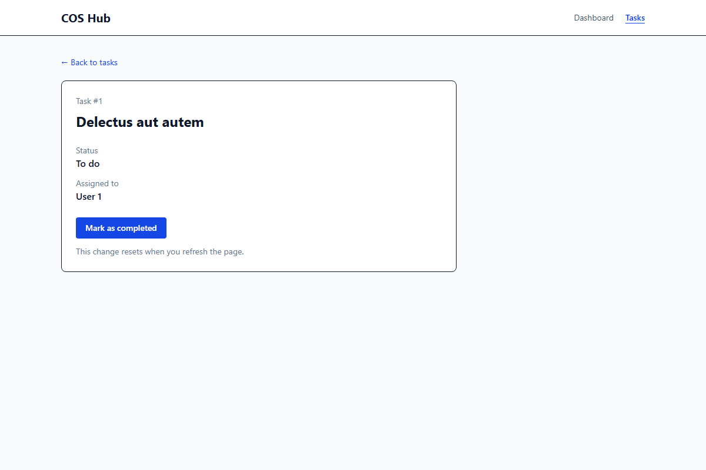

# Mini-project 1 - React Task & Productivity Manager

## COS Hub (Chief of Staff Hub)

A responsive task manager that displays 20 sample tasks, lets you search and filter them, and lets you change their completion status during your visit. It uses JSONPlaceholder for sample data, so status changes reset when the page is refreshed.

## Features

- `/` — Dashboard with total, completed, and to-do counts plus the next tasks to do.
- `/tasks` — Searchable task list with All, To do, and Completed filters.
- `/tasks/:id` — Task details with title, status, assigned user, and a button to change the status.
- Public API: [JSONPlaceholder](https://jsonplaceholder.typicode.com/) supplies tasks through `GET /todos?_limit=20` and individual tasks through `GET /todos/:id`.
- TanStack Query handles fetching and caching. The app displays loading, error, and empty states, offers a retry button for failed requests, and shows a not-found message for missing tasks.

### Screenshots

#### Dashboard (`/`)



#### Tasks (`/tasks`)



#### Task detail (`/tasks/1`)



## Setup

Requires Node.js and npm. Clone the repository and start the development server:

```bash
git clone https://github.com/ruphina-cylix/mini_project_emeritus.git
cd mini_project_emeritus
npm install
npm run dev
```

Open the local URL printed by Vite. Access to the private GitHub repository is required to clone it.

## Tech stack

React, React Router, TanStack Query, Tailwind CSS, and Vite.
